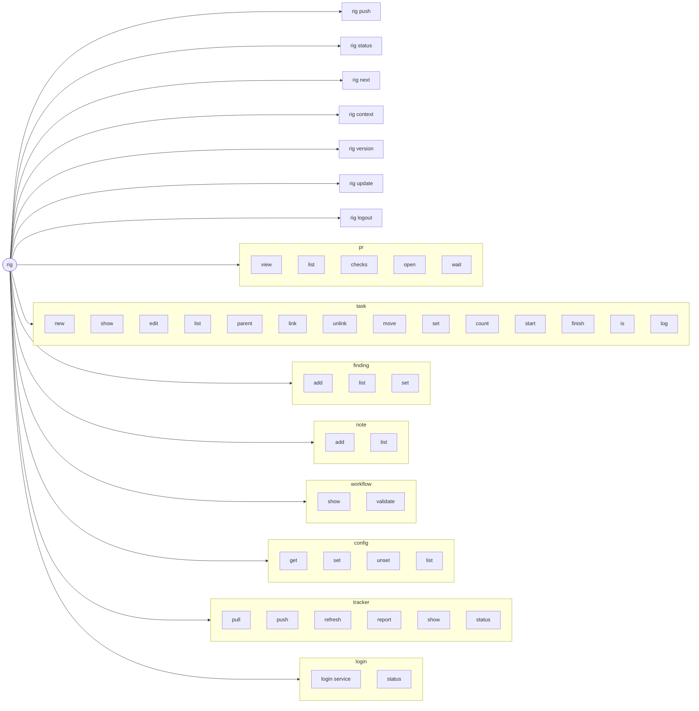
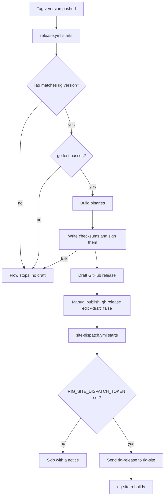

# rig

`rig` is a small command-line tool for the mechanical parts of a
branch-per-task workflow: pushing a task branch, opening and reading pull
requests, waiting for CI, keeping tasks, findings and notes, and printing where
the work stands. It was built for loops where coding agents run these
steps many times a day, but it does not depend on any particular loop.

It exists for two reasons:

- **A narrow push.** `rig push` takes a task id or a branch name and nothing
  else. It cannot push the default branch, a tag, a refspec or a force push,
  so it is safe to allow without a prompt.
- **One interface over two forges.** The same commands and the same output
  work on GitHub and GitLab. rig runs `gh` or `glab` underneath and uses the
  login you already have. It stores a token only for Jira, which has no such
  tool, and then in the OS keychain.
- **Tasks and rules you define.** Tasks, findings and notes live in your
  repository's git directory, outside any branch. A workflow file you write
  says which states a task passes through and what must be true before each
  move, and rig refuses a move that breaks it. See
  [docs/workflows.md](docs/workflows.md).

## Install

rig needs Go 1.24 or later, `git`, and `gh` (GitHub) or `glab` (GitLab).

```bash
go install github.com/AindriuB/rig/cmd/rig@latest
```

Release binaries for five platforms, with a `SHA256SUMS` file and its
`SHA256SUMS.sig` signature, are on the project's GitHub release page. Releases
are signed from 0.5.2; earlier releases are not, and `rig update` will not
install them.

### Updating

```bash
rig update            # install the latest release
rig update --check    # report only; exit 1 when a newer release exists
rig update --to 0.5.2 # install a given release
```

`rig update` replaces the running binary with the release binary for your
platform. That includes a copy you built with `go install`: it is replaced by
the release binary built from the same tag, not rebuilt from source. It
downloads only from the project's GitHub releases, and installs only after the
signature, the checksum and a run of the new binary's `version` all pass. If
any of them fails, or the directory is not writable, the installed file is
untouched.

A process that is already running keeps the old binary: on Linux and macOS the
old file is replaced, not edited, so a running process keeps its inode, and on
Windows the old binary is moved to `rig.exe.old` (removed on a later run).
Start rig again to use the new one.

#### Automatic updates

`update.auto` sets what rig does after a command finishes:

- `off` (the default): nothing.
- `notify`: when a newer release exists, print one line to stderr.
- `install`: install it, and print one line to stderr.

Set it in the global file only (`rig config set update.auto notify --global`);
a repository cannot turn it on. rig checks at most once every 24 hours, and
never changes the command's exit code. It does nothing in CI (`CI` set), when
stderr is not a terminal, with `--json`, for `rig update` and `rig version`,
and when the check cannot reach GitHub within 2 seconds.

## Commands

```text
rig push <task-id|branch> [--worktree <path>]
rig pr view [<pr|branch> | --task <id>] [--json] [--repo <dir>]
rig pr list [--mine] [--head <branch>] [--state open|closed|merged] [--limit <n>] [--json] [--repo <dir>]
rig pr checks [<pr|branch> | --task <id>] [--json] [--repo <dir>]
rig pr open --head <branch> --title <text> [--base <branch>] [--body <text>] [--draft] [--repo <dir>]
rig pr wait <pr-number | --run <run-id>> [--repo <dir>]
rig status [--json]
rig task new --slug <s> --title <text> [--body <text> | --body-file <path>] [--field <name>=<value>]... [--actor <name>] [--json] [--repo <dir>]
rig task new --from [<kind>:]<key> [--state <s>] [--slug <s>] [--field <name>=<value>]... [--actor <name>] [--json] [--repo <dir>]
rig task show <task> [--findings] [--notes] [--history] [--children] [--format <text|json|markdown> | --json | --markdown] [--repo <dir>]
rig task edit <task> [--actor <name>] [--json] [--repo <dir>]
rig task list [--state <s>]... [--all] [--parent <task> | --roots | --tree] [--format <text|json|markdown> | --json | --markdown] [--repo <dir>]
rig task parent <task> <parent|none> [--actor <name>] [--json] [--repo <dir>]
rig task link <task> [<kind>:]<key> [--actor <name>] [--json] [--repo <dir>]
rig task unlink <task> [--actor <name>] [--json] [--repo <dir>]
rig task move <task> <state> [--sha <sha>] [--pr <n>] [--reason <text>] [--actor <name>] [--json] [--repo <dir>]
rig task set <task> --field <name>=<value>... [--actor <name>] [--json] [--repo <dir>]
rig task count <task> <counter> [--actor <name>] [--json] [--repo <dir>]
rig task start <slug> [--task-file <path>] [--json] [--repo <dir>]
rig task finish <task> --sha <sha> [--json] [--repo <dir>]
rig task is <task> <state> [--repo <dir>]
rig task log <task> [--json] [--repo <dir>]
rig finding add <task> --severity <sev> --summary <text> [--path <p[:line]>] [--key <k>] [--field <name>=<value>]... [--actor <name>] [--json] [--repo <dir>]
rig finding list <task> [--status <s>]... [--blocking] [--json] [--repo <dir>]
rig finding set <task> <finding> --status <s> [--actor <name>] [--json] [--repo <dir>]
rig note add [<task>] --kind <k> --text <text> [--actor <name>] [--json] [--repo <dir>]
rig note list [<task>] [--kind <k>] [--limit <n>] [--json] [--repo <dir>]
rig workflow show [--json] [--repo <dir>]
rig workflow validate [<file>] [--json] [--repo <dir>]
rig next [--who agent|human] [--limit <n>] [--json] [--repo <dir>]
rig context <task> [--budget <tokens>] [--format <text|json|markdown> | --json | --markdown] [--repo <dir>]
rig config get <key> [--global|--repo|--local] [--json]
rig config set <key> <value> --global|--repo|--local
rig config unset <key> --global|--repo|--local
rig config list [--global|--repo|--local] [--show-origin] [--json]
rig tracker pull <key> | --query <q> | --label <l> [--children[=<depth>]] [--limit <n>] [--state <s>] [--actor <name>] [--json] [--repo <dir>]
rig tracker push <task> [--tree] [--dry-run] [--actor <name>] [--json] [--repo <dir>]
rig tracker refresh [<task> | --all] [--dry-run] [--actor <name>] [--json] [--repo <dir>]
rig tracker report <task> [--status] [--comment pr|state|summary] [--include findings|notes]... [--dry-run] [--actor <name>] [--json] [--repo <dir>]
rig tracker show <key> [--json] [--repo <dir>]
rig tracker status [--json] [--repo <dir>]
rig login                                  (the forge, then Jira when tracker.kind is jira)
rig login <service> [--url <site>] [--user <email>] [--token] [--repo] [--store keychain|file]   (github, gitlab or jira; the flags are for jira; --token stores a personal access token, with no user; --pat is the 0.4.0 name and still works)
rig login status [--json]
rig logout <service> [--url <site>] [--repo]   (jira; github and gitlab print the gh/glab command)
rig version
rig update [--check] [--to <version>] [--json]
```

`--actor <name>` (alias `--role <name>`) is accepted by the commands above that
write the store, and by no other. It sets the actor recorded on each event the
command writes: a label for the audit trail, not authentication. The actor is
the flag, else `$RIG_ACTOR`, else git's `user.name`, else `unknown`. The value
is trimmed; an empty one, one with a control character, or `--actor` and
`--role` given with different values is exit 2, with nothing written.

| Command | What it does | Exit codes |
|---|---|---|
| `rig push` | Pushes one branch to `origin`. A task id such as `07` resolves to `task/07-<slug>`. | 0 pushed; 1 the push failed; 2 refused, git never ran |
| `rig pr view`, `checks`, `list` | Prints pull requests and their CI state in one neutral form. | 0; 2 on any error |
| `rig pr open` | Opens a pull request for a branch that is already pushed. It never pushes. | 0; 2 on any error |
| `rig pr wait` | Blocks until a pull request's checks, or one CI run, finish. | 0 green; 1 red; 2 error or timeout |
| `rig status` | Prints the handoff note, task files, worktrees and open pull requests, then a view of the store: open tasks with their effective states, and open findings. The store view reads only local data and makes no network call. | 0; 2 on a usage error |
| `rig task`, `rig finding`, `rig note` | Create and read tasks, findings and notes, and move a task between states. `rig task is` answers "is it in this state?" with its exit code. | 0; 1 refused by a workflow gate, nothing written; 2 on any error |
| `rig task show --children`, `rig task list --parent`, `--roots`, `--tree` | Show a task with its children; list the children of one task, the tasks with no parent, or all tasks as a forest. | as `rig task` |
| `rig task parent <task> <parent\|none>` | Sets or clears a task's parent. A missing parent or a cycle is refused. | 0; 1 refused, nothing written; 2 on any error |
| `rig task new --from [<kind>:]<key>` | Creates a task linked to a tracker issue and copies the issue's fields into it. If the issue is already linked, prints that task, with a note on stderr. `--state` must be one of the workflow's intake states. | 0; 1 refused (`--state`); 2 on any error |
| `rig task link <task> [<kind>:]<key>`, `rig task unlink <task>` | Links an existing task to an issue and refreshes it, or removes the link and keeps the fields. A linked task's owned fields cannot be changed by `rig task set` or `rig task edit`. | 0; 1 refused (issue already linked; task not linked); 2 on any error |
| `rig task start <slug>`, `rig task finish <task> --sha <sha>` | `start` makes a git worktree and branch `task/<slug>` for a task file and ties the worktree to it. `finish` merges exactly the verified commit into the default branch and removes the worktree. | 0; 1 refused, nothing changed (a merge conflict is aborted); 2 on any error |
| `rig tracker pull` | Creates linked tasks from one issue, a search or a label, and with `--children` the issue's sub-issues. | 0; 1 `--state` refused; 2 on any error, or if any issue failed |
| `rig tracker push` | Creates an issue on the tracker for a task that has none, and with `--tree` for its unlinked descendants, then links each. The type comes from the workflow's `tracker.push`. `--dry-run` prints what would be sent. | 0; 1 refused before anything is created; 2 on any other error, including a create that failed part way |
| `rig tracker refresh` | Re-reads linked issues and overwrites the owned fields of their tasks with the tracker's values. `--dry-run` writes nothing. | 0; 2 on any error, or if any task failed |
| `rig tracker report` | Sends a linked task's progress to its issue: a status from the workflow's `tracker.report.status`, then a comment (`pr`, `state` or `summary`; findings and notes only with `--include`). With neither `--status` nor `--comment` it sends the status and a `state` comment. Each send is recorded in a `tracker-report` event (the status as `from`, `to` and the requested `asked`). A repeat that changes nothing is skipped; `--dry-run` prints what would be sent. | 0; 1 no status mapped for the state, no such transition, or no pull request for `--comment pr`, with nothing sent; 2 on any other error |
| `rig tracker show`, `rig tracker status` | Prints one issue; or prints the tracker kind, whether its configuration is trusted, what it supports and whether the login works, and, for Jira, whether the configured project exists. Neither writes. | 0; 2 on any error |
| `rig workflow` | Shows the workflow in effect, or checks a workflow file. | 0; `validate` 1 invalid; 2 on any error |
| `rig next`, `rig context` | List what each open task needs, and print a size-limited brief for one task. They never call the forge. | 0; 2 on any error |
| `rig config` | Reads and writes settings in `~/.rig/config.json` (`--global`, `--repo`) or `<repo>/.rig/config.json` (`--local`). `rig config set` needs a scope. | 0; `get` 1 not set; 2 on any error |
| `rig login`, `rig logout` | `login` hands over to `gh` or `glab` for GitHub and GitLab, and stores a Jira token in the keychain. `rig login status` shows where you are logged in, never a token. | 0; 1 a login failed; 2 on any error |

`--format markdown` (or `--markdown`) prints `rig task show`, `rig task list`
and `rig context` as Markdown, for people and for agents that read prose;
`--format json` is the same as `--json`, and `--format text` is the default.
Naming two different formats, or an unknown one, is exit 2.

An unknown flag always exits 2. `--json` output and the exit codes are a
stable contract, described in [docs/design.md](docs/design.md). The store and
the task commands are described in [docs/phase-2.md](docs/phase-2.md), config
and login in [docs/phase-2.5.md](docs/phase-2.5.md), and the workflow file
format, with a worked example, in [docs/workflows.md](docs/workflows.md).

Tasks live in `refs/rig/` and `.git/rig/` of the clone, so they stay on your
machine: rig does not push or fetch them, and a repository looks the same to
anyone who does not use rig. With no setup, rig uses a small built-in
`basic` workflow (`open`, `active`, `done`).

The command map groups every command by its first word.



## What `rig push` will push

A branch is pushed only if all of these hold:

- it is `<prefix>/<name>`, and the prefix is in `pushPrefixes` (by default
  `task` and `record`);
- it uses only letters, digits and `. _ / -`;
- it is not the repository's default branch;
- it exists locally.

It is pushed to the branch of the same name on `origin`. There is no option
for another remote, a force push or tags.

## Configuration

`rig config` holds the newer settings (the forge, the tracker, the workflow);
see [docs/phase-2.5.md](docs/phase-2.5.md). `.claude/rig.json` in the
repository is optional and still read. Every key has a default.

| Key | Meaning | Default |
|---|---|---|
| `forge` | `github` or `gitlab` | detected from the origin host |
| `host` | the forge's host, for a self-hosted instance | the origin host |
| `pushPrefixes` | branch prefixes `rig push` may push | `["task", "record"]` |

`pushPrefixes` widens what `rig push` can do without a prompt, so treat the
file as yours: do not let an agent edit it unasked.

The keys of `rig config` (see `rig config list`) are:

| Key | Meaning | Default |
|---|---|---|
| `forge.kind`, `forge.host` | The forge, and its host for a self-hosted instance | detected from the origin host |
| `push.prefixes` | Branch prefixes `rig push` may push. Never from `.rig/config.json` | `["task", "record"]` |
| `workflow` | A workflow preset name or an absolute path. Global file only | `basic` |
| `tracker.kind` | `local`, `jira`, `github`, `gitlab` or `exec` | `local` (no tracker) |
| `tracker.url` | The tracker's `https://` address. A tracked `.rig/config.json` cannot supply it | none |
| `tracker.project` | A Jira project key, `owner/name`, or `group/.../name` | the origin remote's path (GitHub, GitLab) |
| `tracker.command` | For `exec`: the program and its arguments. Global file only | none |
| `tracker.jira.api` | `auto`, `v2` or `v3` | `auto` |
| `tracker.jira.epicField` | The Jira Server or Data Center "Epic Link" field id | found by name |
| `tracker.jira.acceptanceField` | The Jira field id that holds acceptance criteria | none |
| `update.auto` | `off`, `notify` or `install`: what rig does after a command when a newer release exists. Global file only | `off` |
| `worktrees.root` | Where `rig task start` puts worktrees: `<root>/<repo name>/<slug>` | `.worktrees` |

`worktrees.root` is relative to the repository's main checkout, or absolute.
A value that comes from the repository's own `.rig/config.json` (or the
default) must be a relative path without a `..` element, and after symlinks
are resolved the worktree must still be under the checkout; otherwise `rig task
start` stops with an error. Only the global file may point outside the
checkout, with an absolute path. `tracker.url` has a trust rule of its own:
see [docs/workflows.md](docs/workflows.md#linking-tasks-to-a-tracker).

## Pushing tasks to a tracker

`rig tracker push` makes issues from tasks. It sends each task's title, body,
type, parent and one `rig/...` marker label. With a Jira tracker that has
`tracker.jira.acceptanceField` set, it also sends the acceptance criteria. It
sends nothing else; the marker lets a re-run find an issue an earlier run made
instead of creating a second one.

```bash
rig tracker push 07 --tree --dry-run   # show what would be created
rig tracker push 07 --tree             # create task 07's issue and its subtasks' issues
```

The issue types come from `tracker.push.levels` in the workflow file (see
[docs/workflows.md](docs/workflows.md#the-tracker-key)). After a push the
tracker owns the title and body: `rig task set` and `rig task edit` refuse to
change them, and `rig tracker refresh` copies the tracker's values back.
Details, and what happens when a push stops part way, are in
[docs/phase-3.5.md](docs/phase-3.5.md).

## Development

```bash
go vet ./...
```

```bash
go test ./...
```

The tests use throwaway git repositories and stub `gh` and `glab` programs, so
they need no network and no login. The code is in three layers: commands in
`cmd/rig`, the forge interface in `internal/forge`, and one adapter per forge
below it. [docs/design.md](docs/design.md) has the full design and the phases
planned next.

## Releasing

1. Set `version` in `cmd/rig/version.go`. A new command, flag or JSON field
   raises the minor version; a change to an existing one raises the major.
2. Tag the commit `v<version>` and push the tag.
3. The release workflow builds the binaries and drafts a GitHub release.
4. When the tag is pushed, `release.yml` checks that the tag matches
   `rig version` and runs `go test`. It then builds the binaries, writes the
   checksums and signs them, and drafts a GitHub release. A failing step stops
   the flow and no draft is made.
5. Publish the draft by hand with `gh release edit <tag> --draft=false`.
6. Publishing triggers `site-dispatch.yml`, which sends `rig-release` to
   rig-site, and rig-site rebuilds. Without the `RIG_SITE_DISPATCH_TOKEN`
   secret the dispatch is skipped with a notice and rig-site does not rebuild.



## License

Copyright 2026 Andrew Bannister. Licensed under the Apache License,
Version 2.0; see [LICENSE](LICENSE).
